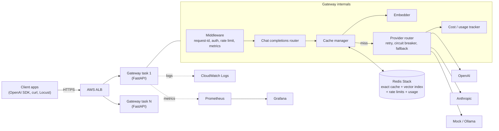
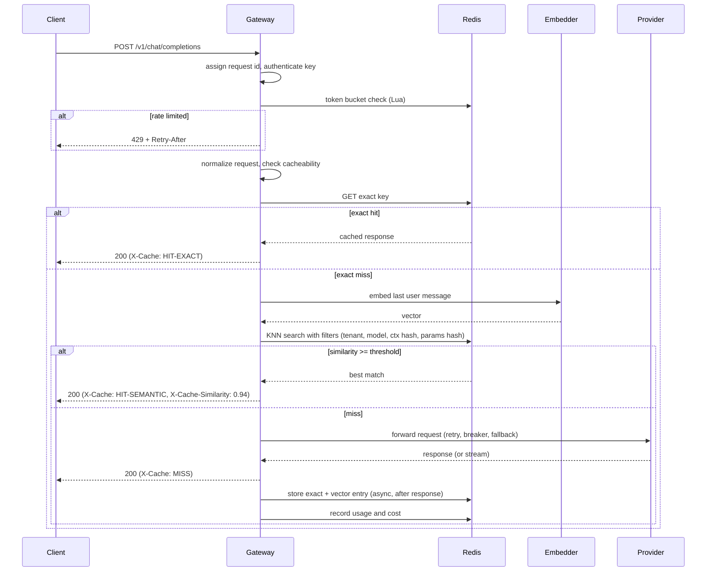
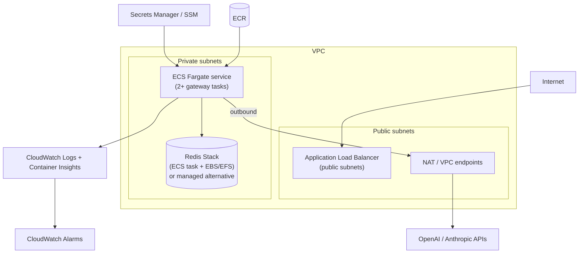

# Project 1: LLM Gateway with Semantic Caching ("CacheGate")

> **Audience:** Google Antigravity agent (and the human developer supervising it).
> **Goal:** Build, test, benchmark, and deploy a production-style LLM gateway on AWS with measurable results suitable for a resume flagship project.
> **Working name:** `cachegate` (rename freely).

---

## Table of Contents

1. [Instructions for the Antigravity Agent](#1-instructions-for-the-antigravity-agent)
2. [Why This Project Exists](#2-why-this-project-exists)
3. [Problems It Solves](#3-problems-it-solves)
4. [Advantages and Value](#4-advantages-and-value)
5. [Scope: Features and Non-Goals](#5-scope-features-and-non-goals)
6. [Tech Stack](#6-tech-stack)
7. [System Architecture](#7-system-architecture)
8. [Request Lifecycle](#8-request-lifecycle)
9. [Semantic Cache Design (the core)](#9-semantic-cache-design-the-core)
10. [API Specification](#10-api-specification)
11. [Data Models and Redis Schema](#11-data-models-and-redis-schema)
12. [Repository Structure](#12-repository-structure)
13. [Configuration](#13-configuration)
14. [Implementation Phases](#14-implementation-phases)
15. [Testing Strategy](#15-testing-strategy)
16. [Benchmarking and Evaluation](#16-benchmarking-and-evaluation)
17. [Observability](#17-observability)
18. [AWS Deployment](#18-aws-deployment)
19. [CI/CD](#19-cicd)
20. [Security Considerations](#20-security-considerations)
21. [Definition of Done](#21-definition-of-done)
22. [Resume Bullets and Interview Talking Points](#22-resume-bullets-and-interview-talking-points)
23. [Stretch Goals](#23-stretch-goals)

---

## 1. Instructions for the Antigravity Agent

Follow these rules for the whole build.

1. **Work phase by phase** (Section 14). Do not start a phase until the previous phase's acceptance criteria pass. After each phase, produce an Artifact/summary listing what was built, tests run, and results.
2. **Tests first or alongside code.** Every module gets unit tests. No phase is complete with failing tests.
3. **Type hints everywhere** (Python 3.11+), `ruff` for lint/format, `mypy` in strict-ish mode for `src/`.
4. **Never hardcode secrets.** Use environment variables and `.env.example`. Never commit real keys.
5. **Use a Mock LLM provider** for all tests and load tests so no real money is spent. Real providers are only for a small manual smoke test.
6. **Keep abstractions clean:** `Provider`, `VectorStore`, `Embedder`, and `RateLimiter` must be interfaces (ABC/Protocol) with swappable implementations.
7. **Everything async.** Use `async`/`await`, `httpx.AsyncClient`, and `redis.asyncio`.
8. **Document as you go.** Maintain `README.md`, `docs/architecture.md`, and `docs/benchmarks.md`. The README must contain an architecture diagram (Mermaid), quickstart, and benchmark results table.
9. **Record real numbers.** Benchmarks must be run and results saved under `benchmarks/results/`. Do not invent metrics.
10. **If a requirement is ambiguous,** pick the simplest reasonable option, record it in `docs/decisions.md` (ADR style, 3-5 lines each), and continue.

---

## 2. Why This Project Exists

### The context

Almost every AI product today calls hosted LLM APIs (OpenAI, Anthropic, Google, open-source models on vLLM/Ollama). As usage grows, teams hit the same operational wall:

- LLM calls are **slow** (1 to 10+ seconds per response).
- LLM calls are **expensive** (billed per token, and costs scale linearly with traffic).
- LLM providers **rate-limit and fail** (429s, 5xx, regional outages).
- Many user prompts are **repeated or near-duplicates** ("How do I reset my password?" vs "how can i reset my password").
- Teams have **no central visibility** into who is spending what.

Companies solve this with an **LLM gateway**: a proxy between applications and model providers that adds caching, routing, rate limiting, observability, and cost control. Real-world examples include LiteLLM, Portkey, Helicone, Cloudflare AI Gateway, and Kong AI Gateway. Building one demonstrates you understand LLM *infrastructure*, not just LLM *usage*.

### Why it is a strong resume flagship

| Signal to recruiters | How this project shows it |
|---|---|
| Systems and backend skills | Async API, streaming, rate limiting, circuit breakers |
| AI engineering beyond API calls | Embeddings, vector search, similarity thresholds, cache correctness |
| Production mindset | Metrics, dashboards, load tests, CI/CD, IaC |
| Cloud skills | Deployed on AWS (ECS Fargate, ALB, ElastiCache/Redis, CloudWatch) |
| Quantitative thinking | Hit rate, p95 latency, cost saved, false-hit rate with numbers |
| Cost awareness | Every feature ties to dollars or milliseconds saved |

---

## 3. Problems It Solves

| # | Problem | How the gateway solves it |
|---|---|---|
| 1 | **High LLM cost** from repeated or similar prompts | Exact + semantic cache returns stored answers at near-zero cost |
| 2 | **High latency** (seconds per call) | Cache hits return in milliseconds (target: p95 under 50 ms on hit) |
| 3 | **Provider outages / 429s** | Retries with backoff, circuit breaker, automatic fallback to a secondary provider |
| 4 | **Runaway usage / abuse** by one client | Per-API-key rate limiting (token bucket) and budget caps |
| 5 | **Vendor lock-in** | One OpenAI-compatible API in front of many providers; swap providers via config |
| 6 | **No cost visibility** | Per-key, per-model token and dollar tracking exposed via Prometheus/Grafana |
| 7 | **Scattered API keys** in every service | Provider keys live only in the gateway; clients get gateway-issued keys |
| 8 | **Debugging blind spots** | Structured logs, request IDs, traces, and cache hit/miss headers |

### What it deliberately does *not* claim to solve

Semantic caching is a tradeoff. A wrong cache hit returns an answer to a *different* question. The project therefore treats **cache correctness (false-hit rate)** as a first-class metric, not an afterthought. This is a major differentiator from tutorial-level projects.

---

## 4. Advantages and Value

**Business advantages**
- Cut LLM spend on repetitive workloads (FAQ bots, support assistants, internal copilots) by a measurable percentage.
- Lower tail latency, improving user experience.
- Higher availability through multi-provider fallback.
- Predictable budgets via quotas.

**Technical advantages**
- Drop-in compatibility: any app using the OpenAI SDK only needs to change `base_url`.
- Pluggable architecture: new providers, embedders, and vector stores are one class each.
- Streaming support, including replaying cached responses as streams so clients cannot tell the difference.
- Safe by default: cache isolation per tenant, per model, per system prompt, and per sampling parameters.

**Career advantages**
- Gives you concrete, defensible numbers for interviews.
- Touches system design topics interviewers love: caching strategies, TTL/eviction, rate limiting algorithms, idempotency, backpressure, observability.

---

## 5. Scope: Features and Non-Goals

### Must-have features (MVP)

1. **OpenAI-compatible endpoint** `POST /v1/chat/completions` (non-streaming and SSE streaming).
2. **Two-tier cache**
   - Tier 1: exact-match cache (hash of normalized request).
   - Tier 2: semantic cache (embedding similarity via vector search).
3. **Multi-provider routing** with adapters: Mock (for tests), OpenAI, Anthropic, and optionally Gemini/Ollama.
4. **Resilience:** timeouts, retries with exponential backoff + jitter, circuit breaker, fallback chain.
5. **Rate limiting:** per-API-key token bucket (Redis + Lua for atomicity).
6. **Auth:** gateway API keys (hashed in storage), with per-key limits and budget.
7. **Cost and token accounting** per key and model.
8. **Observability:** Prometheus metrics, structured JSON logs, request IDs, response headers (`X-Cache`, `X-Cache-Similarity`, `X-Request-Id`).
9. **Admin endpoints:** create/revoke keys, flush cache, view stats.
10. **Dockerized**, with `docker-compose` for local dev (gateway + Redis Stack + Prometheus + Grafana).
11. **Deployed on AWS** with Infrastructure as Code.
12. **Benchmark + evaluation suite** producing real numbers.

### Non-goals (do not build)

- A UI/dashboard app (Grafana is enough).
- Fine-tuning or hosting models.
- Full multi-region deployment.
- Billing/payment integration.

---

## 6. Tech Stack

### Application

| Layer | Choice | Reason |
|---|---|---|
| Language | **Python 3.11+** | Best AI ecosystem, async support |
| Web framework | **FastAPI** + **Uvicorn** (Gunicorn workers in prod) | Async, typed, auto OpenAPI docs |
| HTTP client | **httpx** (async) | Streaming and connection pooling |
| Validation/config | **Pydantic v2**, **pydantic-settings** | Typed schemas and env config |
| Cache / state store | **Redis Stack** (RediSearch vector index, HNSW) | One system for exact cache, vectors, rate limits |
| Redis client | **redis-py** (`redis.asyncio`) | Async, supports RediSearch commands |
| Embeddings | **sentence-transformers** `all-MiniLM-L6-v2` (384-dim, runs locally on CPU) | Free, fast; no per-call cost. Optional: OpenAI `text-embedding-3-small` via adapter |
| Resilience | Custom circuit breaker + **tenacity** for retries | Shows you understand the pattern |
| Token counting | **tiktoken** (approximate for non-OpenAI models) | Cost estimation |
| Logging | **structlog** (JSON) | Queryable logs in CloudWatch |
| Metrics | **prometheus-client** | Standard, Grafana-compatible |
| Tracing (optional) | **OpenTelemetry** | Stretch goal |

### Quality and testing

| Purpose | Tool |
|---|---|
| Unit/integration tests | **pytest**, **pytest-asyncio**, **fakeredis** or **testcontainers** (real Redis Stack) |
| HTTP mocking | **respx** |
| Lint/format | **ruff** |
| Types | **mypy** |
| Load testing | **Locust** (primary) or **k6** |
| Eval datasets | **Quora Question Pairs** (paraphrase / non-paraphrase), **STS-B**, or a self-built FAQ set |
| Analysis | **pandas**, **matplotlib**, **scikit-learn** (ROC/PR curves for threshold tuning) |

### Infrastructure

| Purpose | Tool |
|---|---|
| Containers | **Docker**, **docker-compose** |
| IaC | **Terraform** (or AWS CDK in Python) |
| Compute | **AWS ECS Fargate** behind an **Application Load Balancer** |
| Image registry | **Amazon ECR** |
| Cache/vector store | See note below |
| Secrets | **AWS Secrets Manager** (or SSM Parameter Store, cheaper) |
| Logs/metrics | **CloudWatch Logs**, **CloudWatch Container Insights**; Prometheus + Grafana (local, or Amazon Managed Prometheus/Grafana optional) |
| CI/CD | **GitHub Actions** (OIDC to AWS, no long-lived keys) |
| Autoscaling | ECS Service Auto Scaling (target tracking on CPU / requests per target) |

> **Important note on the AWS vector store.** Vector search requires a Redis-compatible service with vector support. Plain ElastiCache for Redis OSS does **not** include RediSearch. Pick one and record it in `docs/decisions.md` (verify current AWS feature availability before deciding):
> - **Option A (cheapest, simplest):** run `redis/redis-stack-server` as a container on ECS/EC2 with an EBS volume. Good for a portfolio project.
> - **Option B (managed):** Amazon ElastiCache for Valkey with vector search support, or Amazon MemoryDB (supports vector search).
> - **Option C:** Aurora/RDS PostgreSQL with **pgvector** (then Redis is used only for exact cache + rate limiting).
>
> Because `VectorStore` is an interface, switching later is a small change. Default to Option A for MVP, document Option B as the production recommendation.

---

## 7. System Architecture

### 7.1 High-level diagram



### 7.2 Component responsibilities

| Component | Responsibility |
|---|---|
| **Middleware** | Assign `X-Request-Id`, authenticate API key, enforce rate limit, record latency metrics |
| **Router** | Validate OpenAI-style request, decide streaming vs non-streaming, orchestrate cache then provider |
| **Cache Manager** | Normalize request, build cache keys, run exact then semantic lookup, decide cacheability, store results |
| **Embedder** | Turn text into vectors; run in a thread pool so it does not block the event loop; batch where possible |
| **VectorStore** | Create index, upsert entries, KNN query with metadata filters, TTL handling |
| **Provider Router** | Pick provider by model name/alias, apply timeout, retry, circuit breaker, fallback chain |
| **Usage Tracker** | Count tokens, compute cost, increment per-key counters, enforce budgets |
| **Admin API** | Key management, cache flush, stats |

### 7.3 Design principles

- **Stateless gateway tasks.** All state (cache, limits, usage) lives in Redis so tasks scale horizontally.
- **Fail open on cache errors.** If Redis is down, bypass the cache and call the provider (log + metric). Never fail a user request because the cache is unhealthy.
- **Fail closed on auth/rate-limit decisions** when Redis is reachable; if Redis is unreachable, use a configurable policy (`RATE_LIMIT_FAIL_OPEN=true` by default for the MVP).
- **Cache correctness over hit rate.** Prefer a miss to a wrong answer.

---

## 8. Request Lifecycle



Step-by-step:

1. **Assign request ID**, bind to logging context.
2. **Authenticate** the `Authorization: Bearer <gateway_key>` header (compare hash).
3. **Rate limit** with an atomic Redis Lua token bucket. Return `429` with `Retry-After` if exceeded.
4. **Normalize** the request (Section 9.2) and decide **cacheability** (Section 9.4).
5. **Exact lookup** by SHA-256 of the canonical request. Hit returns immediately.
6. **Semantic lookup:** embed the final user message, run filtered KNN (k=3), take the top candidate, and compare cosine similarity to the threshold.
7. **On miss,** call the provider through the resilience layer.
8. **Respond to the client first,** then **write to cache in a background task** (do not add cache-write latency to the user).
9. **Record usage:** prompt/completion tokens, cost, saved cost (on hits), latency.

---

## 9. Semantic Cache Design (the core)

This section is the most important part of the project. Implement it carefully.

### 9.1 Cache entry contents

Each entry stores: tenant ID, model, system-prompt hash, parameters hash, context hash, the embedded text, the vector, the full serialized response, token counts, created-at, TTL, and a hit counter.

### 9.2 Normalization (for exact key and embedding text)

- Lowercase and trim whitespace for the *embedding text* only (never alter what is sent to the provider).
- Collapse repeated whitespace.
- Canonical JSON for the exact key: sorted keys, only fields that affect output (`model`, `messages`, `temperature`, `top_p`, `max_tokens`, `stop`, `tools`, `response_format`, `seed`).
- Exclude fields that do not affect output (`user`, `stream`, request metadata).

### 9.3 Partitioning (what must match for a semantic hit)

A semantic match is only valid if **all** of these are identical (applied as vector-search filters/tags):

| Filter | Why |
|---|---|
| `tenant_id` | Prevent cross-customer data leakage |
| `model` (resolved alias) | Different models give different answers |
| `system_prompt_hash` | Different personas/instructions change the answer |
| `params_hash` (temperature, top_p, max_tokens, response_format, tools) | Sampling config changes output |
| `context_hash` (hash of all messages *before* the last user message) | Multi-turn: same last question in different conversations is a different question |

Then the **embedding is computed only over the last user message.** Single-turn chats (empty context) get the best hit rate; multi-turn requires identical prior context.

### 9.4 Cacheability rules (do NOT cache when...)

- `temperature > CACHE_MAX_TEMPERATURE` (default `0.3`), since high temperature implies the user wants variation.
- Request includes **tool/function calls** or the response contains `tool_calls` (configurable, default skip).
- Response `finish_reason` is not `stop` (e.g., truncated by `length`, or `content_filter`).
- Client sends `Cache-Control: no-cache` or `X-Cache-Bypass: true`.
- Prompt appears time-sensitive (optional heuristic: contains "today", "now", "current", "latest"; make this a configurable regex list).
- Response is an error.

### 9.5 Similarity and threshold

- Use **cosine similarity** (normalize vectors; use `COSINE` metric in the index).
- RediSearch returns *distance*; convert: `similarity = 1 - distance` for cosine.
- Default threshold: **0.92** for MiniLM. **Do not trust this default.** Phase 8 tunes it using labeled paraphrase pairs and picks the value that meets a target false-hit rate (e.g., under 1%).
- Support **per-tenant threshold override** and an **`X-Cache-Threshold`** request header (clamped to a safe range) for experimentation.

### 9.6 Streaming behavior

- **Cache hit + client wants stream:** replay the stored content as SSE chunks (split by words or small token groups with a tiny configurable delay, default 0 to 5 ms) and end with `data: [DONE]`.
- **Cache miss + stream:** forward the provider stream to the client while accumulating chunks; when `[DONE]` arrives and the finish reason is `stop`, store the assembled response.

### 9.7 TTL and eviction

- Default TTL: 24 hours (`CACHE_TTL_SECONDS`), overridable per request via `X-Cache-TTL`.
- Redis `maxmemory-policy allkeys-lru` (or `volatile-lru`) so memory is bounded.
- Cap entries per tenant (optional).

### 9.8 Stampede protection (single-flight)

If 50 identical requests arrive simultaneously on a cold cache, only **one** should call the provider.

- Use a Redis lock (`SET key NX PX`) keyed by the exact-request hash. Others wait briefly (poll or pub/sub), then read from cache.
- In-process `asyncio` futures map for same-task coalescing, plus Redis lock for cross-task coalescing.
- This is a great interview talking point; implement and benchmark it.

### 9.9 Cache invalidation

- `DELETE /admin/cache` (flush by tenant, model, or all).
- TTL expiry.
- Version prefix in keys (`CACHE_SCHEMA_VERSION`) so changing the embedding model or normalization instantly invalidates old entries.

---

## 10. API Specification

### 10.1 Public API (OpenAI-compatible)

`POST /v1/chat/completions`

Request body (subset to support):

```json
{
  "model": "gpt-4o-mini",
  "messages": [
    {"role": "system", "content": "You are a helpful assistant."},
    {"role": "user", "content": "How do I reset my password?"}
  ],
  "temperature": 0.0,
  "max_tokens": 256,
  "stream": false
}
```

Response: standard OpenAI chat completion JSON plus headers:

| Header | Values |
|---|---|
| `X-Request-Id` | UUID |
| `X-Cache` | `HIT-EXACT`, `HIT-SEMANTIC`, `MISS`, `BYPASS` |
| `X-Cache-Similarity` | float (semantic hits only) |
| `X-Provider` | provider that served a miss |
| `X-Gateway-Latency-Ms` | gateway-measured time |
| `X-RateLimit-Remaining` | tokens remaining |

Other public endpoints:

| Method | Path | Purpose |
|---|---|---|
| `GET` | `/v1/models` | List configured model aliases |
| `GET` | `/healthz` | Liveness (process up) |
| `GET` | `/readyz` | Readiness (Redis reachable, embedder loaded) |
| `GET` | `/metrics` | Prometheus metrics (protect or restrict to internal network) |

### 10.2 Admin API (separate admin key)

| Method | Path | Purpose |
|---|---|---|
| `POST` | `/admin/keys` | Create key (name, rate limit, budget); returns the plaintext key once |
| `GET` | `/admin/keys` | List keys (never return plaintext) |
| `DELETE` | `/admin/keys/{id}` | Revoke key |
| `DELETE` | `/admin/cache` | Flush cache (query params: `tenant`, `model`) |
| `GET` | `/admin/stats` | Hit rate, savings, top keys, provider health |

### 10.3 Error format

OpenAI-style:

```json
{"error": {"message": "Rate limit exceeded", "type": "rate_limit_error", "code": "rate_limit_exceeded"}}
```

Status codes: `400` invalid request, `401` bad key, `402`/`429` budget or rate exceeded, `502` upstream failure after fallbacks, `504` upstream timeout.

---

## 11. Data Models and Redis Schema

### 11.1 Key naming (prefix with schema version `v1`)

| Purpose | Key pattern | Type |
|---|---|---|
| Exact cache | `cg:v1:exact:{tenant}:{sha256}` | String (JSON), with TTL |
| Semantic entry | `cg:v1:sem:{tenant}:{uuid}` | Hash (vector + metadata + response), with TTL |
| Vector index | `idx:cg:v1:sem` | RediSearch index over `cg:v1:sem:` |
| Rate limit bucket | `cg:v1:rl:{key_id}` | Hash (tokens, last_refill) |
| Usage counters | `cg:v1:usage:{key_id}:{yyyymmdd}` | Hash (prompt_tokens, completion_tokens, cost_usd, requests, hits) |
| API keys | `cg:v1:apikey:{sha256(key)}` | Hash (id, name, limits, budget, active) |
| Single-flight lock | `cg:v1:lock:{sha256}` | String with short PX |
| Circuit breaker state | in-process (per task); optional shared in Redis | n/a |

### 11.2 Vector index definition (RediSearch)

Fields:

- `embedding` : `VECTOR HNSW`, `TYPE FLOAT32`, `DIM 384`, `DISTANCE_METRIC COSINE`, `M 16`, `EF_CONSTRUCTION 200`
- `tenant` : `TAG`
- `model` : `TAG`
- `sys_hash` : `TAG`
- `params_hash` : `TAG`
- `ctx_hash` : `TAG`
- `created_at` : `NUMERIC` (sortable)

Query shape: `(@tenant:{t} @model:{m} @sys_hash:{s} @params_hash:{p} @ctx_hash:{c})=>[KNN 3 @embedding $vec AS dist]`, `SORTBY dist`, `DIALECT 2`.

### 11.3 Rate limiting (token bucket in Lua)

Single Lua script, atomic: refill = `min(capacity, tokens + elapsed * rate)`; if `tokens >= cost`, decrement and allow; else return deny with `retry_after`. Include unit tests with a fake clock and a concurrency test.

### 11.4 Pricing table

Keep `config/pricing.yaml` mapping model to `$/1M input tokens` and `$/1M output tokens`. Mark values as **configurable and to be verified against provider pricing pages**; do not hardcode assumptions in code. Cost saved on a hit = cost the same request *would have* incurred (use stored token counts).

---

## 12. Repository Structure

```
cachegate/
├── README.md
├── LICENSE
├── pyproject.toml
├── .env.example
├── Makefile
├── docker-compose.yml
├── Dockerfile
├── config/
│   ├── models.yaml            # aliases -> provider/model, fallback chains
│   └── pricing.yaml
├── src/cachegate/
│   ├── main.py                # FastAPI app factory, lifespan (load embedder, connect Redis)
│   ├── settings.py            # pydantic-settings
│   ├── api/
│   │   ├── chat.py            # /v1/chat/completions
│   │   ├── models.py
│   │   ├── health.py
│   │   └── admin.py
│   ├── middleware/
│   │   ├── request_id.py
│   │   ├── auth.py
│   │   ├── rate_limit.py
│   │   └── metrics.py
│   ├── cache/
│   │   ├── manager.py         # orchestrates exact -> semantic -> store
│   │   ├── normalize.py
│   │   ├── keys.py
│   │   ├── policy.py          # cacheability rules
│   │   ├── single_flight.py
│   │   └── stores/
│   │       ├── base.py        # VectorStore interface
│   │       ├── redis_store.py
│   │       └── memory_store.py  # for tests
│   ├── embeddings/
│   │   ├── base.py
│   │   ├── sbert.py
│   │   └── openai_embed.py    # optional
│   ├── providers/
│   │   ├── base.py            # Provider interface
│   │   ├── mock.py            # configurable latency, errors, deterministic output
│   │   ├── openai.py
│   │   ├── anthropic.py
│   │   ├── router.py          # alias resolution, fallback chain
│   │   ├── retry.py
│   │   └── circuit_breaker.py
│   ├── limits/
│   │   ├── base.py
│   │   └── token_bucket.py    # + lua/token_bucket.lua
│   ├── usage/
│   │   ├── tracker.py
│   │   └── pricing.py
│   ├── observability/
│   │   ├── logging.py
│   │   └── metrics.py
│   └── schemas/
│       ├── openai.py          # request/response models
│       └── internal.py
├── tests/
│   ├── unit/
│   ├── integration/           # real Redis Stack via testcontainers
│   └── conftest.py
├── benchmarks/
│   ├── locustfile.py
│   ├── datasets/              # paraphrase pairs, FAQ set
│   ├── eval_cache_quality.py  # threshold sweep, ROC/PR, false-hit rate
│   ├── run_load_test.sh
│   └── results/               # CSVs, plots, summary.md
├── infra/
│   ├── terraform/             # vpc, ecs, alb, ecr, redis, iam, secrets, cloudwatch
│   └── grafana/
│       ├── dashboards/cachegate.json
│       └── prometheus.yml
├── docs/
│   ├── architecture.md
│   ├── decisions.md
│   ├── benchmarks.md
│   └── runbook.md
└── .github/workflows/
    ├── ci.yml
    └── deploy.yml
```

---

## 13. Configuration

`.env.example` (illustrative; all overridable):

```bash
# App
APP_ENV=dev
LOG_LEVEL=INFO
ADMIN_API_KEY=change-me

# Redis
REDIS_URL=redis://localhost:6379/0

# Providers (leave blank to use mock only)
OPENAI_API_KEY=
ANTHROPIC_API_KEY=
PROVIDER_TIMEOUT_SECONDS=30
PROVIDER_MAX_RETRIES=2

# Cache
CACHE_ENABLED=true
CACHE_SCHEMA_VERSION=v1
CACHE_TTL_SECONDS=86400
CACHE_MAX_TEMPERATURE=0.3
SEMANTIC_THRESHOLD=0.92
SEMANTIC_TOP_K=3
EMBEDDING_MODEL=sentence-transformers/all-MiniLM-L6-v2
EMBEDDING_DIM=384

# Rate limiting
RATE_LIMIT_DEFAULT_RPS=5
RATE_LIMIT_DEFAULT_BURST=20
RATE_LIMIT_FAIL_OPEN=true

# Resilience
BREAKER_FAILURE_THRESHOLD=5
BREAKER_RECOVERY_SECONDS=30
```

`config/models.yaml` example:

```yaml
models:
  gpt-4o-mini:
    primary: openai/gpt-4o-mini
    fallbacks: [anthropic/claude-haiku, mock/echo]
  mock-fast:
    primary: mock/echo
    fallbacks: []
```

(Replace model names with whatever is current; keep them in config, not code.)

---

## 14. Implementation Phases

Each phase lists **tasks** and **acceptance criteria**. Do them in order.

### Phase 0: Scaffold

**Tasks**
- Create repo structure, `pyproject.toml` (dependencies pinned), `Makefile` (`make dev`, `make test`, `make lint`, `make bench`).
- Dockerfile (multi-stage, non-root user), `docker-compose.yml` with `gateway`, `redis-stack`, `prometheus`, `grafana`.
- Pre-download the embedding model in the Docker build so cold starts are fast.
- CI skeleton running ruff + mypy + pytest.

**Acceptance:** `docker compose up` starts all services; `/healthz` returns 200; CI passes.

### Phase 1: Core gateway with Mock provider

**Tasks**
- Pydantic models for OpenAI request/response.
- `POST /v1/chat/completions` (non-streaming) routed to `MockProvider`.
- Mock provider: deterministic reply derived from input, configurable latency (e.g., 800 ms default), configurable error rate, token counts.
- Request ID middleware, structured logging.

**Acceptance:** Official OpenAI Python SDK pointed at the gateway `base_url` gets a valid response.

### Phase 2: Real providers + streaming

**Tasks**
- OpenAI and Anthropic adapters translating to/from the internal schema.
- SSE streaming passthrough with correct chunk format and `[DONE]`.
- Model alias resolution from `models.yaml`.

**Acceptance:** Streaming works end to end with the OpenAI SDK (`stream=True`); mock streaming tests pass; one manual smoke test against a real provider succeeds.

### Phase 3: Resilience layer

**Tasks**
- Timeouts, retries with exponential backoff + jitter (retry only on 429/5xx/timeouts, never on 4xx validation errors).
- Circuit breaker (closed, open, half-open) per provider.
- Fallback chain across providers; response carries `X-Provider`.

**Acceptance:** Tests simulate provider failure: breaker opens after N failures, requests fall back, breaker recovers after the cooldown.

### Phase 4: Exact cache

**Tasks**
- Normalization, canonical key hashing, cacheability policy.
- Redis exact cache with TTL.
- `X-Cache` headers, cache bypass header.
- Background cache write after the response is sent.

**Acceptance:** Repeating an identical request returns `HIT-EXACT` in under 20 ms (local) and skips the provider (assert provider call count).

### Phase 5: Semantic cache

**Tasks**
- `Embedder` interface + sentence-transformers implementation (run in a thread pool executor; load once at startup).
- RediSearch index creation at startup (idempotent).
- Filtered KNN lookup, similarity conversion, threshold decision.
- Store entries on miss; honor partition filters.
- Streaming replay on hits; stream accumulation on misses.

**Acceptance:** Paraphrased question returns `HIT-SEMANTIC` with similarity in the header; a different-tenant, different-model, different-system-prompt, or different-context request does **not** hit.

### Phase 6: Auth, rate limiting, usage and cost

**Tasks**
- API key creation (store SHA-256 hash only), admin endpoints.
- Lua token bucket limiter; `429` + `Retry-After`; `X-RateLimit-Remaining`.
- Usage tracker: tokens, cost, requests, hits, **cost saved**.
- Optional daily budget enforcement.

**Acceptance:** Burst test exceeds limit and is throttled correctly; usage counters match expected values in an integration test.

### Phase 7: Single-flight and hardening

**Tasks**
- Single-flight coalescing (in-process + Redis lock).
- Fail-open behavior when Redis/embedder errors occur (with metrics).
- Request size limits, input validation, graceful shutdown.

**Acceptance:** Test fires 100 concurrent identical requests on a cold cache and asserts the provider was called once. Killing Redis mid-run does not cause 5xx responses.

### Phase 8: Observability

**Tasks**
- Prometheus metrics (Section 17), Grafana dashboard JSON committed to the repo.
- JSON logs with request ID, key ID, cache result, latency, provider.

**Acceptance:** Grafana shows live hit rate, latency percentiles, and cost saved while a load test runs.

### Phase 9: Evaluation and benchmarking

**Tasks**
- Cache quality evaluation (Section 16.1) and threshold tuning.
- Load test scenarios (Section 16.2) producing latency/throughput/cost numbers.
- Write `docs/benchmarks.md` with tables and plots.

**Acceptance:** Results saved in `benchmarks/results/`; chosen threshold justified with data; README has the headline numbers.

### Phase 10: AWS deployment

**Tasks**
- Terraform for VPC, subnets, security groups, ECR, ECS cluster/service/task definition, ALB (HTTPS if a domain is available), Redis option chosen in Section 6, IAM roles, Secrets Manager, CloudWatch log groups and alarms.
- Deploy workflow via GitHub Actions (OIDC).
- Run the load test against the deployed endpoint; record numbers.
- Provide `terraform destroy` instructions and a cost note to avoid surprise bills.

**Acceptance:** Public ALB URL serves the API; OpenAI SDK works against it; CloudWatch shows logs; autoscaling policy configured; deployed benchmark numbers recorded.

### Phase 11: Documentation polish

**Tasks**
- README with: problem statement, Mermaid architecture, quickstart (3 commands), config table, benchmark table, design tradeoffs, limitations, and a short demo GIF/screenshot of Grafana.
- `docs/runbook.md` (how to deploy, rollback, flush cache, rotate keys).

**Acceptance:** A new developer can run the project locally from the README in under 10 minutes.

---

## 15. Testing Strategy

| Level | What to cover |
|---|---|
| **Unit** | Normalization, key hashing, cacheability policy, similarity conversion, token bucket (fake clock), circuit breaker state machine, pricing math, schema validation |
| **Integration** | Real Redis Stack via testcontainers: index creation, filtered KNN, TTL expiry, Lua limiter atomicity, single-flight lock |
| **API** | `httpx.AsyncClient` against the ASGI app: auth failures, rate limits, headers, streaming format, error shapes |
| **Failure injection** | Provider timeouts, 429/500 bursts, Redis down, embedder exception |
| **Concurrency** | 100 simultaneous identical requests, 100 distinct requests, mixed load |
| **Contract** | OpenAI SDK compatibility test (non-streaming and streaming) |

Target: **80%+ line coverage** on `src/`, with all critical paths (cache decision logic, limiter, breaker) near 100%.

---

## 16. Benchmarking and Evaluation

### 16.1 Cache quality evaluation (the differentiator)

**Goal:** choose a similarity threshold with evidence and report false-hit rate.

**Dataset:** Quora Question Pairs (labeled duplicate / not duplicate) and/or a self-built FAQ set of ~200 questions with 3 to 5 paraphrases each, plus hard negatives (similar wording, different meaning, e.g., "How do I enable 2FA?" vs "How do I disable 2FA?").

**Method**
1. Embed all pairs with the chosen model.
2. Compute cosine similarity per pair.
3. Sweep thresholds from 0.70 to 0.99.
4. For each threshold, compute: **hit rate on true paraphrases (recall)**, **false-hit rate on non-paraphrases (1 - precision related)**, precision, F1.
5. Plot precision-recall and false-hit-vs-hit-rate curves.
6. Choose the lowest threshold that keeps false-hit rate below the target (e.g., under 1%). Record in `docs/decisions.md`.
7. *(Stretch)* Compare embedding models (MiniLM vs bge-small vs OpenAI embeddings) on the same metrics.
8. *(Stretch)* Add a reranker/verification step (cross-encoder or a cheap LLM judge) for borderline similarities and measure the precision gain vs latency cost.

**Reported metrics:** best threshold, hit rate at threshold, false-hit rate at threshold, embedding latency (p50/p95).

### 16.2 Load testing scenarios (Locust or k6)

Use the **Mock provider with realistic latency** (e.g., 800 to 1500 ms, plus some jitter) so the results are reproducible and free.

| Scenario | Workload | What it proves |
|---|---|---|
| **A. Baseline, cache off** | 100 users, mixed prompts | Latency/throughput without caching |
| **B. Cache on, realistic repetition** | Zipf-distributed prompts with paraphrase variants (some prompts popular, long tail) | Hit rate, latency, cost reduction |
| **C. Cold-start stampede** | 200 identical requests at once | Single-flight effectiveness (provider calls = 1) |
| **D. Provider failure** | Mock provider returns 5xx for 60 s | Fallback + breaker behavior, error rate |
| **E. Rate limit enforcement** | One key at 10x its limit | Correct 429s, no impact on other keys |
| **F. Soak** | 30 to 60 minutes steady load | Memory stability, no leaks, Redis memory bounded |

**Record for each:** requests/sec, p50/p95/p99 latency (split by `X-Cache` value), error rate, cache hit rate (exact + semantic), provider calls avoided, estimated cost vs baseline, CPU/memory of tasks, Redis memory.

### 16.3 Headline metrics to produce (fill with *real* measured values)

| Metric | Baseline (no cache) | With CacheGate | Improvement |
|---|---|---|---|
| p50 latency | measured | measured | measured |
| p95 latency | measured | measured | measured |
| Cache hit rate (exact + semantic) | 0% | measured | n/a |
| Cost per 1K requests (est.) | measured | measured | measured % |
| Throughput (req/s at p95 under target) | measured | measured | measured |
| False-hit rate (eval set) | n/a | measured | n/a |
| Provider calls during stampede (200 identical) | 200 | measured (expect ~1) | measured |

---

## 17. Observability

### Prometheus metrics (names are suggestions)

| Metric | Type | Labels |
|---|---|---|
| `cg_requests_total` | Counter | `route`, `status`, `cache_result`, `model` |
| `cg_request_duration_seconds` | Histogram | `route`, `cache_result` |
| `cg_cache_lookup_duration_seconds` | Histogram | `tier` (exact/semantic) |
| `cg_embedding_duration_seconds` | Histogram | none |
| `cg_cache_hits_total` | Counter | `tier`, `tenant` |
| `cg_cache_similarity` | Histogram | none (distribution of hit similarities) |
| `cg_provider_requests_total` | Counter | `provider`, `status` |
| `cg_provider_duration_seconds` | Histogram | `provider` |
| `cg_circuit_breaker_state` | Gauge | `provider` (0 closed, 1 half-open, 2 open) |
| `cg_tokens_total` | Counter | `type` (prompt/completion), `model`, `key_id` |
| `cg_cost_usd_total` | Counter | `model`, `key_id` |
| `cg_cost_saved_usd_total` | Counter | `model`, `key_id` |
| `cg_rate_limited_total` | Counter | `key_id` |
| `cg_cache_errors_total` | Counter | `operation` |
| `cg_singleflight_coalesced_total` | Counter | none |

### Grafana dashboard panels

Hit rate (exact vs semantic), latency percentiles by cache result, requests/sec, error rate, cost vs cost saved, provider health and breaker state, rate-limit rejections, similarity distribution, Redis memory.

### Logging

JSON lines with: `request_id`, `key_id`, `model`, `cache_result`, `similarity`, `provider`, `latency_ms`, `prompt_tokens`, `completion_tokens`, `status`. **Do not log full prompts or responses by default** (privacy). Add `LOG_PROMPTS=false` flag for debugging only.

---

## 18. AWS Deployment

### 18.1 Target architecture



### 18.2 Resources (Terraform modules)

- **Networking:** VPC, 2 public + 2 private subnets across 2 AZs, route tables, security groups (ALB to gateway on app port only; gateway to Redis on 6379 only).
- **ECR:** repository with image scanning on push and lifecycle policy.
- **ECS:** Fargate cluster, task definition (CPU/memory sized for the embedding model, e.g., start with 1 vCPU / 2 to 4 GB and measure), service with rolling deploys and health checks on `/readyz`.
- **ALB:** target group, health check, listener (HTTPS with ACM certificate if you own a domain; otherwise HTTP for the demo and note it).
- **Redis:** per the option chosen in Section 6.
- **IAM:** task execution role (pull image, read secrets, write logs), task role (least privilege).
- **Secrets:** provider API keys and admin key in Secrets Manager or SSM Parameter Store, injected as container secrets.
- **Autoscaling:** target tracking on average CPU (e.g., 60%) and/or ALB request count per target; min 2, max 6 for the demo.
- **CloudWatch:** log group with retention (e.g., 14 days), alarms for 5xx rate, p95 latency, unhealthy hosts, and task CPU.

### 18.3 Deployment steps (for the runbook)

1. Build and push the image to ECR (via CI).
2. `terraform apply` for infrastructure.
3. Create the first admin key / client key.
4. Smoke test with the OpenAI SDK pointed at the ALB DNS name.
5. Run the load test from a separate machine (or EC2 in the same region) and save results.
6. **Tear down with `terraform destroy` after capturing screenshots and metrics** to avoid ongoing charges (NAT gateways, ALB, and Fargate tasks bill hourly).

### 18.4 Cost-control notes

- NAT gateways are a common surprise cost; consider VPC endpoints or placing tasks in public subnets with tight security groups for a demo (document the tradeoff).
- Use the Mock provider for load tests; use real providers only for a handful of smoke requests.
- Set an AWS Budget alert before deploying.

---

## 19. CI/CD

**`ci.yml` (on every PR):** checkout, set up Python, install deps with cache, `ruff check`, `ruff format --check`, `mypy`, `pytest` (with a Redis Stack service container), coverage report, Docker build.

**`deploy.yml` (on tag or main):** authenticate to AWS via **GitHub OIDC** (no static AWS keys), build + push image to ECR tagged with the commit SHA, update the ECS task definition, deploy with a rolling update, wait for service stability, run a post-deploy smoke test against `/readyz` and one chat request.

---

## 20. Security Considerations

- Store only **SHA-256 hashes** of gateway API keys; show plaintext once at creation.
- Strict **tenant isolation** in cache keys and vector filters (test explicitly).
- Restrict `/metrics` and `/admin/*` (separate admin key, ideally network-restricted).
- Never log secrets or (by default) prompt content.
- Validate and bound request size, `max_tokens`, and message count.
- **PII caution:** cached responses can contain sensitive data; support per-tenant cache disable and TTLs; document this in the README.
- Dependency scanning (`pip-audit` or Dependabot) and container image scanning in ECR.
- Run the container as a non-root user with a read-only root filesystem where possible.
- Pin dependencies and the base image.

---

## 21. Definition of Done

The project is complete when **all** are true:

- [ ] OpenAI SDK works against the gateway (streaming and non-streaming), locally and on AWS.
- [ ] Exact cache, semantic cache, partition isolation, and cacheability rules are implemented and tested.
- [ ] Retry, circuit breaker, and fallback are implemented and tested with failure injection.
- [ ] Rate limiting, auth, and cost/usage tracking work and are tested.
- [ ] Single-flight demonstrably reduces provider calls to ~1 on a 200-request cold stampede.
- [ ] Prometheus + Grafana dashboard committed and working.
- [ ] Threshold chosen from a documented evaluation with a measured false-hit rate.
- [ ] Load test results (baseline vs cached) saved with real numbers and plots.
- [ ] Deployed on AWS via Terraform, with CI/CD via GitHub Actions.
- [ ] 80%+ test coverage; CI is green.
- [ ] README includes architecture diagram, quickstart, benchmark table, tradeoffs, and limitations.
- [ ] `docs/decisions.md` records key design choices (vector store, embedding model, threshold, TTL, fail-open policy).

---

## 22. Resume Bullets and Interview Talking Points

### Resume template (replace `X`/`Y` with your **measured** numbers)

**CacheGate: LLM Gateway with Semantic Caching** | Python, FastAPI, Redis Stack (vector search), AWS ECS Fargate, Terraform, Prometheus/Grafana | [GitHub link]

- Built an OpenAI-compatible LLM gateway with two-tier (exact + embedding-based) caching, multi-provider fallback, and per-key rate limiting; **cut p95 latency by X% and estimated LLM cost by Y%** on a repetitive-workload benchmark (Z% cache hit rate).
- Tuned the semantic similarity threshold using labeled paraphrase pairs, achieving **X% paraphrase hit rate at under Y% false-hit rate**; isolated cache by tenant, model, system prompt, and sampling parameters to prevent incorrect or leaked responses.
- Implemented single-flight request coalescing, circuit breakers, and retries with jitter; reduced provider calls from **200 to ~1** on a cold-cache stampede and sustained **X req/s** under provider failure injection.
- Deployed on **AWS (ECS Fargate, ALB, Terraform, GitHub Actions OIDC CI/CD)** with Prometheus/Grafana and CloudWatch observability; load-tested at **X req/s with p95 under Y ms**.

### Interview questions you should be able to answer

1. Why cosine similarity, and why normalize vectors? What does HNSW trade off (recall vs speed vs memory)?
2. How did you pick the threshold? What happens if it is too low or too high?
3. How do you stop a semantic cache from returning a wrong answer to a different user or context?
4. Why not cache high-temperature requests?
5. Explain the cache stampede problem and how single-flight solves it.
6. Token bucket vs sliding window vs leaky bucket; why Lua for atomicity?
7. How does your circuit breaker work, and what are the three states?
8. Why fail open on cache errors? What are the risks?
9. How would you scale this to 10x traffic? (Embedding service separation, sharded Redis, GPU embeddings, async batch embedding.)
10. How would you measure cache *quality* in production? (Sampling hits for LLM-judge audits, user feedback signals, shadow-mode comparison.)

---

## 23. Stretch Goals

- **Verification step for borderline hits:** cross-encoder or small LLM judge to confirm equivalence, measured for precision gain vs added latency.
- **Embedding model comparison** (MiniLM vs bge-small vs OpenAI embeddings) with a results table.
- **Adaptive thresholds** per tenant using feedback signals.
- **Prompt compression / prefix caching awareness** for provider-native prompt caching.
- **OpenTelemetry tracing** with spans for cache lookup, embedding, and provider call.
- **Budget alerts** (email/Slack webhook when a key crosses 80% of budget).
- **Shadow mode:** on semantic hits, asynchronously call the provider and compare answers to estimate real-world cache correctness.
- **Multi-region read replicas / Redis cluster** and a write-up of consistency tradeoffs.
- **Support `/v1/embeddings` and `/v1/completions`** endpoints with the same cache.

---

## Appendix A: Suggested Prompt to Kick Off Antigravity

> "Read `LLM_GATEWAY_PROJECT_SPEC.md` fully. Start with Phase 0 and Phase 1 only. Create the repository structure, Docker setup, and a FastAPI app with a Mock provider behind `/v1/chat/completions`. Write tests, run them, and produce a summary artifact of what you built and the test results. Do not proceed to Phase 2 until I confirm."

Then proceed one or two phases per prompt, reviewing each summary before approving the next.

## Appendix B: Glossary

| Term | Meaning |
|---|---|
| **LLM gateway** | Proxy between apps and LLM providers adding caching, routing, limits, and observability |
| **Semantic cache** | Cache keyed by meaning (embedding similarity) instead of exact text |
| **Embedding** | Numeric vector representing the meaning of text |
| **HNSW** | Graph-based approximate nearest-neighbor index |
| **Cosine similarity** | Angle-based similarity between vectors (1 = same direction) |
| **False-hit rate** | Fraction of cache hits that returned an answer to a *different* question |
| **Single-flight** | Coalescing identical in-flight requests so only one hits the backend |
| **Circuit breaker** | Pattern that stops calling a failing dependency and probes for recovery |
| **Token bucket** | Rate limiting algorithm allowing bursts up to a capacity, refilled at a steady rate |
| **TTL** | Time-to-live; how long a cache entry remains valid |
