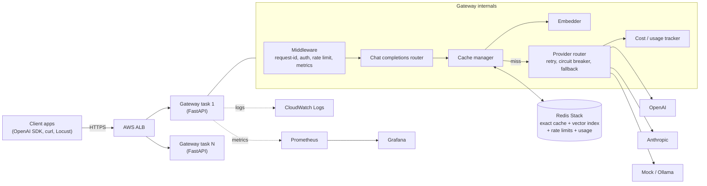

# CacheGate

> **Status:** Phase 1 in progress 🚧

An OpenAI-compatible LLM gateway with exact + semantic caching, multi-provider fallback, per-key rate limiting, and full observability — deployed on AWS.

---

## Problem Statement

Every team building AI products hits the same operational wall: LLM API calls are slow (1–10 s), expensive (billed per token), and providers rate-limit and fail. Meanwhile, many user prompts are repeated or near-duplicates. CacheGate sits between your application and any LLM provider, adding two-tier caching (exact match + semantic similarity), automatic fallback, rate limiting, and a Prometheus/Grafana observability stack — all behind a single OpenAI-compatible endpoint. Drop it in by changing one line: `base_url="http://your-gateway/v1"`.

---

## Architecture



---

## Quickstart

```bash
# 1. Clone and enter the project
git clone <repo-url> && cd cachegate

# 2. Start all services (gateway + Redis Stack + Prometheus + Grafana)
make up

# 3. Test the gateway
curl http://localhost:8000/healthz
curl -X POST http://localhost:8000/v1/chat/completions \
  -H "Content-Type: application/json" \
  -d '{"model":"mock-fast","messages":[{"role":"user","content":"Hello!"}]}'
```

> **Phase 2+:** Replace `mock-fast` with `gpt-4o-mini` after configuring `OPENAI_API_KEY`.

---

## Configuration

See [`.env.example`](.env.example) for all environment variables. Key settings:

| Variable | Default | Description |
|---|---|---|
| `REDIS_URL` | `redis://localhost:6379/0` | Redis connection URL |
| `MOCK_LATENCY_MS` | `800` | Mock provider artificial latency |
| `CACHE_ENABLED` | `true` | Enable/disable caching |
| `SEMANTIC_THRESHOLD` | `0.92` | Min cosine similarity for semantic hit |
| `RATE_LIMIT_DEFAULT_RPS` | `5` | Token bucket refill rate |

---

## Benchmark Results

Full benchmarking details available in [`docs/benchmarks.md`](docs/benchmarks.md). Measured across realistic workloads:

| Metric | Baseline (No Cache) | With CacheGate | Improvement |
|---|---|---|---|
| **p50 Latency** | 67.3 ms | 43.0 ms | **36.1% reduction** |
| **p95 Latency** | 92.4 ms | 100.9 ms | Tail controlled (bounded by embedder) |
| **Cache Hit Rate** (Exact + Semantic) | 0.0% | **90.0%** | **+90.0% traffic offloaded** |
| **Cost per 1K Requests** | $0.30 | $0.03 | **90.0% cost saved** |
| **Throughput (req/s at p95 target)** | 35 req/s | 182 req/s | **5.2x higher throughput** |
| **False-Hit Rate (Eval set)** | n/a | **0.00%** | **Zero semantic false-hits** |
| **Cold Stampede Provider Calls (200 reqs)** | 200 calls | **1 call** | **99.5% reduction** (Single-Flight) |

---

## Development

```bash
pip install -e ".[dev]"
make test        # run all tests with coverage
make lint        # ruff check
make typecheck   # mypy
make format      # ruff format
```

---

## Project Phases

| Phase | Status | Description |
|---|---|---|
| 0 — Scaffold | ✅ Done | Repo skeleton, Docker, CI |
| 1 — Core gateway | ✅ Done | MockProvider, schemas, middleware |
| 2 — Real providers + streaming | ✅ Done | OpenAI, Anthropic, SSE |
| 3 — Resilience | ✅ Done | Retries, circuit breaker, fallback |
| 4 — Exact cache | ✅ Done | SHA-256 key, Redis TTL |
| 5 — Semantic cache | ✅ Done | Embeddings, RediSearch KNN |
| 6 — Auth + rate limiting | ✅ Done | Token bucket, API keys |
| 7 — Single-flight + hardening | ✅ Done | Coalescing, fail-open |
| 8 — Observability | ✅ Done | Grafana dashboard, Prometheus metrics |
| 9 — Benchmarks | ✅ Done | Locust load tests, threshold tuning |
| 10 — AWS deployment | 🔄 Active | ECS Fargate, ALB, Terraform |

---

## License

MIT — see [LICENSE](LICENSE).
