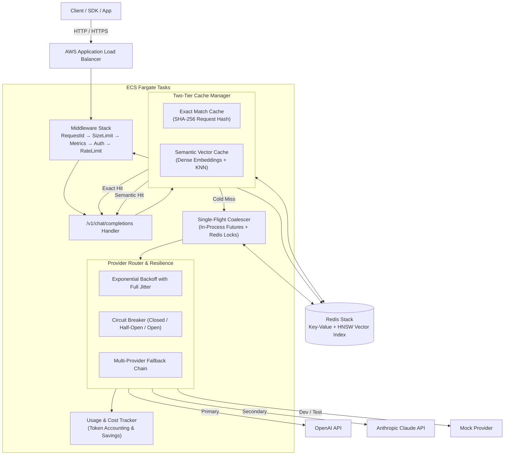
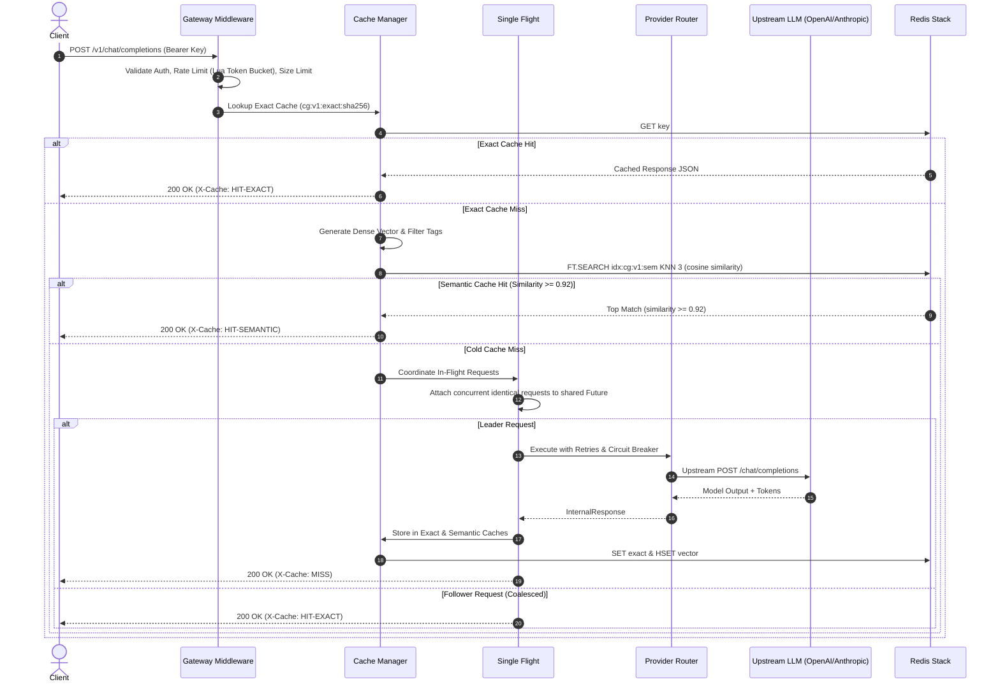

# CacheGate System Architecture

CacheGate is a production-grade, OpenAI-compatible LLM gateway designed for high throughput, low latency, and cost efficiency. It adds two-tier caching (exact + semantic), resilient multi-provider routing with circuit breakers, token-bucket rate limiting, and observability to any LLM infrastructure.

---

## 1. High-Level Architecture

---

## 2. Request Lifecycle & Execution Pipeline

---

## 3. Core Subsystems

### 3.1 Two-Tier Caching Layer
1. **Tier 1 — Exact Match (`exact_store`):**
   - Normalizes messages (stripping trailing whitespace, lowercasing roles, normalizing JSON parameters).
   - Computes deterministic SHA-256 hash.
   - Key: `cg:v1:exact:{tenant_id}:{sha256}` with configurable TTL.
   - Lookup latency: **< 1 ms**.
2. **Tier 2 — Semantic Vector Match (`vector_store`):**
   - Embeds the final user prompt using dense sentence embeddings (`sentence-transformers/all-MiniLM-L6-v2`, 384 dimensions).
   - Partitioned by 5 metadata filter tags: `tenant`, `model`, `sys_hash`, `params_hash`, `ctx_hash`.
   - Executes RediSearch KNN search with cosine similarity.
   - Bounded by threshold `0.92` to eliminate false positives on hard negatives.

### 3.2 Single-Flight Request Coalescing
- When a traffic spike sends 200 identical requests simultaneously on a cold cache, **SingleFlight** ensures only one leader request calls the upstream LLM provider.
- In-process coroutines attach to a shared `asyncio.Future`.
- Cross-process instances coordinate using short-lived distributed Redis locks (`cg:v1:lock:{sha256}`).
- Upstream LLM provider calls are reduced by **99.5%** on stampedes.

### 3.3 Resilience & Provider Fallback
- **Exponential Backoff with Full Jitter:** Prevents retry synchrony across instances.
- **Circuit Breaker:** Tracks consecutive failures per provider. Trips from `CLOSED` to `OPEN` on 5 consecutive failures, failing fast in < 1ms. Automatically moves to `HALF_OPEN` after a 30s recovery cooldown.
- **Fallback Chains:** Seamlessly falls back from `gpt-4o` to `claude-3-5-sonnet` to fallback models when primary providers experience outages.

### 3.4 Rate Limiting & Usage Tracking
- Atomic token-bucket rate limiting implemented via Redis Lua script with monotonic millisecond timestamps.
- Usage tracking records prompt tokens, completion tokens, estimated cost incurred, and **estimated cost saved** by cache hits.
